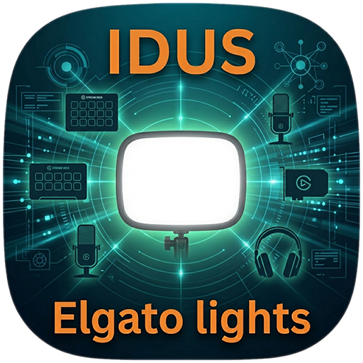
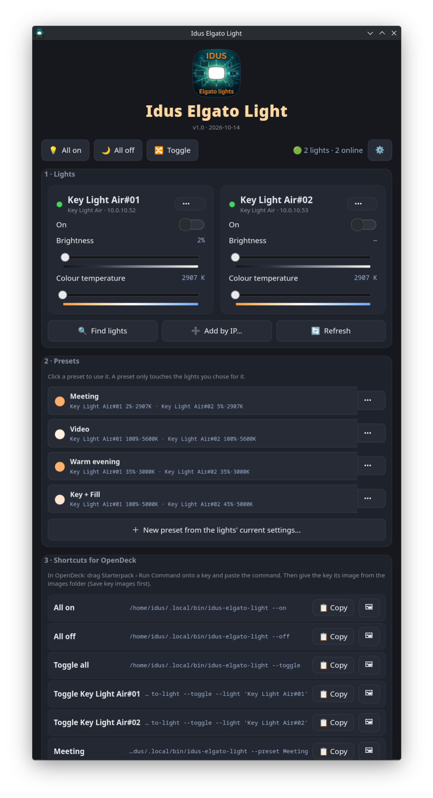

<div align="center">



# Idus Elgato Light

**Elgato Key Light, Ring Light and Light Strip on Linux — presets, and a ready OpenDeck key for every action.**

A small GTK4 app that controls Elgato Wi-Fi lights straight over their built-in HTTP API — an
Elgato Control Center alternative for Linux, no Windows or macOS needed. It finds the lights on your network,
puts them side by side, saves presets for any combination of them, and gives you a
copy-ready command plus a matching key image for every shortcut, so setting up a Stream
Deck in [OpenDeck](https://github.com/nekename/OpenDeck) takes a minute.


</div>

<!-- Add a screenshot here once you have one:

-->

## Elgato on Linux?

Elgato only makes Control Center for Windows and macOS — but the lights don't need it. Key Light,
Key Light Air, Key Light Mini, Ring Light and Light Strip all speak a small HTTP API on your
own network (port 9123), and that's what this app talks to: no cloud, no account, no Wine.
Set the lights up once in the Elgato phone app (to get them on your Wi-Fi), and from then on
Linux is all you need.

## Supported lights

| Light | Controls |
|---|---|
| Key Light · Key Light Air · Ring Light | on/off, brightness, colour temperature (2900–7000 K) |
| Key Light Mini | the same, plus battery level |
| Light Strip | on/off, brightness, hue, saturation |

## Requirements

- Linux, KDE Plasma 6 recommended (any desktop works)
- Python + GTK4 bindings: `sudo pacman -S --needed python-gobject gtk4`
- The lights on the same network as this computer (or add their network in Settings)

## Install

Download the three files (or grab them from [Releases](../../releases)), put them in one
folder, then run:

```bash
bash install-idus-elgato-light.sh
```

- Launch from the menu ("Idus Elgato Light") or the terminal (`idus-elgato-light`).
- **First start** asks if it may search your network. Every light it finds is added, side by
  side — rename, reorder or remove them from each light's ⋯ menu.
- Re-running the installer updates the app and keeps your lights and presets.
- Also listed in [Idus GitHub Updater](https://github.com/Idus/idus-github-updater), which keeps it up to date.

## How it works

### Finding lights

**Find lights** asks the network over mDNS (`_elg._tcp`) and scans this computer's network
for port 9123, then confirms each answer by asking the light what it is. Lights are known by
their serial number, so if your router gives one a new IP address, the app finds it again by
itself. Lights on another VLAN or Wi-Fi network don't answer mDNS here — add that network in
Settings (e.g. `10.0.20.0/24`), or use **Add by IP…**.

### Presets

A preset stores what the lights you pick show right now — on/off, brightness and colour
temperature (or hue and saturation for a Light Strip). **Lights you leave out are not
touched** when the preset is used, so "Fill only" can change one light and leave the other
alone. A few starter presets (Meeting, Video, Warm evening — and Key + Fill with two or more
lights) are made the first time lights are found; change or delete them.

### Shortcuts for OpenDeck

Section 3 lists every action as a command that calls the app by its full path (so OpenDeck
finds it whatever its `PATH` is):

| Shortcut | Command (`idus-elgato-light …`) |
|---|---|
| All on / All off / Toggle all | `--on` · `--off` · `--toggle` |
| Toggle one light | `--toggle --light 'Desk Mini'` |
| A preset | `--preset 'Key + Fill'` |
| Brighter / Dimmer | `--brightness=+10` · `--brightness=-10` |
| Warmer / Cooler | `--kelvin=-300` · `--kelvin=+300` |

In OpenDeck: drag **Starterpack › Run Command** onto a key, press 📋 **Copy** in the app and
paste it into the command field. **Save all key images** writes a 144×144 PNG for every
shortcut — a glowing light in the shortcut's colour with its name — to
`~/Pictures/Idus Elgato Light`, ready to set as the key's image. Steps for brightness and
temperature are set in Settings.

> Renamed a light or a preset? Keys that use the old name need the new command.

### CLI

```bash
idus-elgato-light --on | --off | --toggle           [--light NAME …]
idus-elgato-light --preset NAME
idus-elgato-light --brightness=+10 | =-10 | =60     [--light NAME …]
idus-elgato-light --kelvin=+300 | =-300 | =4500     [--light NAME …]
idus-elgato-light --list                            # lights, their state, presets
idus-elgato-light --scan [--add]                    # find lights on the network
idus-elgato-light --identify NAME                   # make a light blink
```

`NAME` is the light's name, serial number or IP. Exit code 0 = every light answered,
1 = at least one didn't, 2 = unknown light or preset.

## Notes & caveats

- **No password, no cloud.** Elgato lights have an open HTTP API on your local network —
  anyone on that network can switch them, with or without this app. Keep them on a network
  you trust.
- Wi-Fi lights get unhappy with a flood of requests, so a moving slider sends at most
  20 updates a second per light (the final value always arrives).
- The window refreshes the lights every 15 seconds (Settings) to pick up changes made by
  OpenDeck keys or another computer.
- Everything (lights, presets, settings) lives next to the app in
  `~/.local/share/idus-elgato-light/` — one folder backup captures it all.
- Not affiliated with Elgato or Corsair. Elgato, Key Light, Ring Light, Light Strip and
  Stream Deck are trademarks of Corsair Memory, Inc.

## Uninstall

```bash
rm -f  ~/.local/bin/idus-elgato-light ~/.local/share/applications/idus-elgato-light.desktop
rm -rf ~/.local/share/idus-elgato-light ~/.local/share/icons/hicolor/512x512/apps/idus-elgato-light.png
```

## Support

Made by **Idus**. If this saved you time, buy me a coffee:

<a href='https://ko-fi.com/N4N2QZHKK' target='_blank'></a>

## License

MIT — see [LICENSE](LICENSE).
